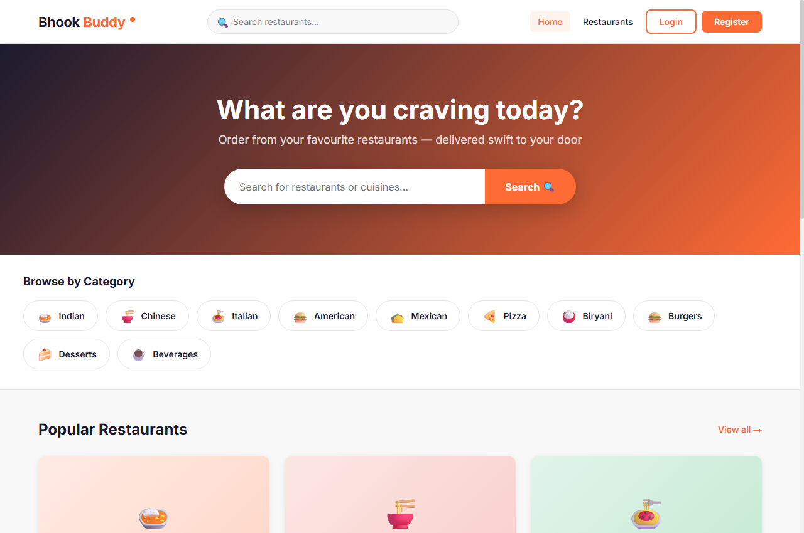
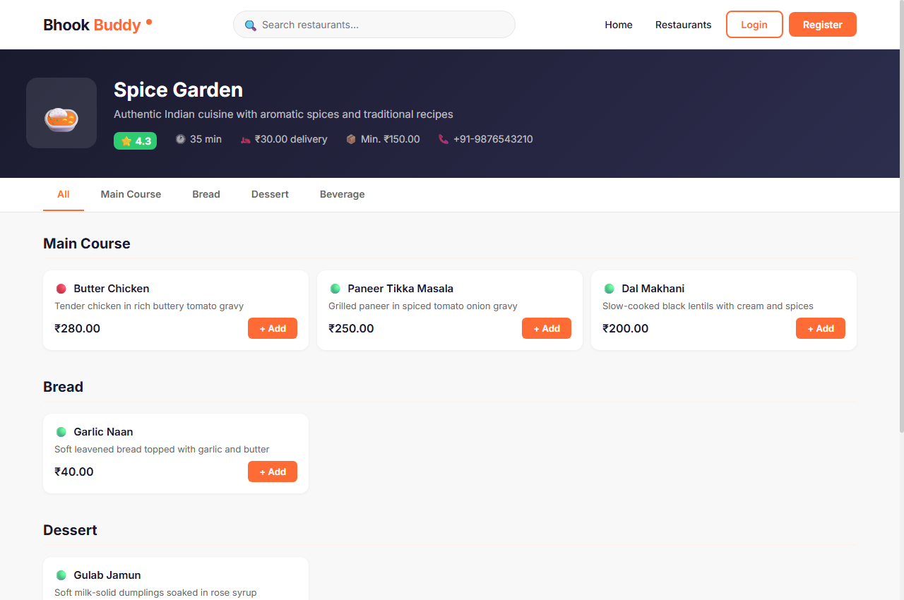
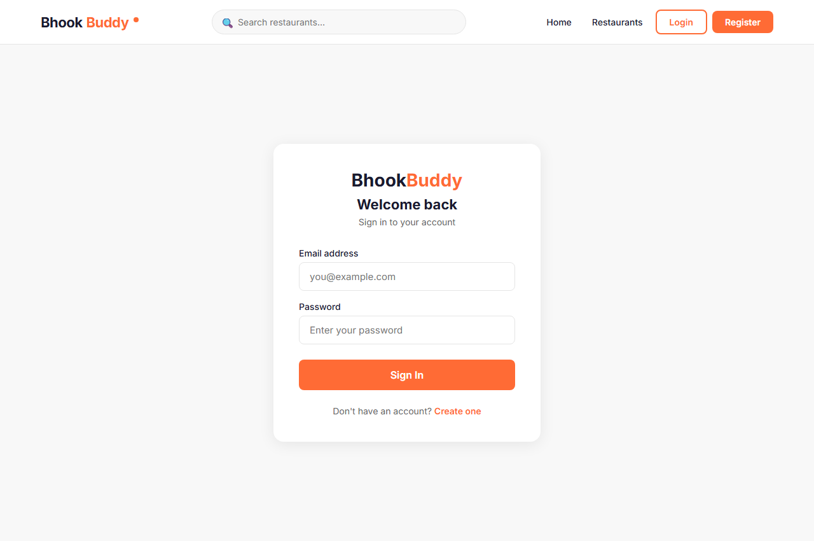
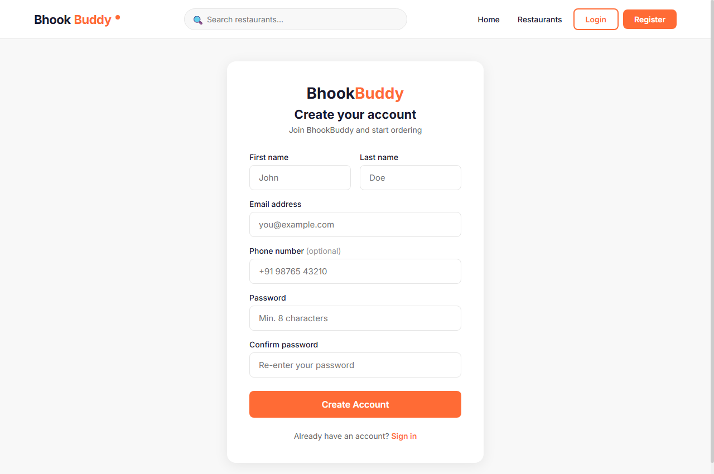
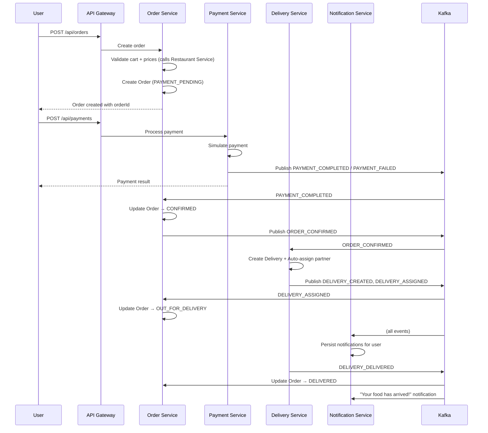

# BhookBuddy — Food Delivery Platform

> "Delicious food, delivered swift."

BhookBuddy is a **portfolio-quality, full-stack microservices food delivery application** demonstrating Java, Spring Boot, Spring Cloud, Apache Kafka, React, and distributed-system design. It is an independently designed and built application — not affiliated with or derived from any commercial delivery platform.

---

## Features

### User Features
- Register, log in, manage profile and saved addresses
- Browse and search restaurants by name, cuisine, or city
- Filter by cuisine category (Indian, Chinese, Italian, Pizza, Burgers, and more)
- View restaurant menus with vegetarian/non-vegetarian indicators
- Add items to cart, update quantities, clear cart
- Full checkout flow: delivery address selection → order placement → mock payment
- Simulate payment success or payment failure (for testing the full event-driven flow)
- Real-time order tracking with status timeline
- Full order history
- In-app notifications for every order lifecycle event

### Admin Features
- Admin dashboard with platform statistics
- Create, edit, activate/deactivate restaurants
- Add, edit, toggle availability of menu items and prices
- View and manage all orders and manually advance order status
- View all payments; issue mock refunds
- View all deliveries and manually update delivery status
- Enable/disable user accounts

---

## 📸 Application Screenshots

| Home & Restaurant Discovery | Restaurant Menu & Ordering |
|:---:|:---:|
|  |  |

| User Login & Authentication | User Registration |
|:---:|:---:|
|  |  |

---

## Technology Stack

| Layer | Technology | Version |
|---|---|---|
| Backend Language | Java | 17 |
| Backend Framework | Spring Boot | 3.2.0 |
| Microservice Infrastructure | Spring Cloud Gateway | 2023.0.0 |
| Persistence | Spring Data JPA / H2 Database | — |
| Security | Spring Security 6 + JJWT | 0.12.3 |
| Messaging | Apache Kafka | 7.5.x (Confluent Docker) |
| API Documentation | SpringDoc OpenAPI / Swagger UI | 2.3.0 |
| Build Tool | Apache Maven | 3.9.x |
| Frontend Framework | React | 18.2 |
| Frontend Language | TypeScript | 5.2 |
| Frontend Build | Vite | 5.0 |
| HTTP Client | Axios | 1.6 |
| Routing | React Router v6 | 6.21 |
| Unit Testing | JUnit 5 + Mockito | — |
| Integration Testing | Spring Boot Test + Kafka Test | — |

---

## Architecture

```
                         React Frontend  (port 3000)
                               │
                               ▼
                         API Gateway      (port 8080)
                      JWT validation + routing
                               │
          ┌────────────────────┼────────────────────┐
          │                    │                    │
          ▼                    ▼                    ▼
     User Service       Restaurant Service     Order Service
      (port 8081)          (port 8082)          (port 8083)
      H2: users            H2: restaurants      H2: orders
                                                     │
                          ┌──────────────────────────┤
                          │                          │
                          ▼                          ▼
                  Payment Service           Delivery Service
                   (port 8084)               (port 8085)
                   H2: payments              H2: deliveries
                          │                          │
                          └──────── Kafka ───────────┘
                                      │
                                      ▼
                            Notification Service
                               (port 8086)
                               H2: notifications
```

### Communication Model

| Type | When Used |
|---|---|
| Synchronous REST | Login, registration, browsing, cart, order creation, payment initiation |
| Asynchronous Kafka | Payment results, order confirmations, delivery creation/updates, notifications |

---

## Microservices

| Service | Port | Database | Swagger UI |
|---|---|---|---|
| api-gateway | 8080 | — (stateless) | — |
| user-service | 8081 | H2 `./data/users` | http://localhost:8081/swagger-ui.html |
| restaurant-service | 8082 | H2 `./data/restaurants` | http://localhost:8082/swagger-ui.html |
| order-service | 8083 | H2 `./data/orders` | http://localhost:8083/swagger-ui.html |
| payment-service | 8084 | H2 `./data/payments` | http://localhost:8084/swagger-ui.html |
| delivery-service | 8085 | H2 `./data/deliveries` | http://localhost:8085/swagger-ui.html |
| notification-service | 8086 | H2 `./data/notifications` | http://localhost:8086/swagger-ui.html |

### Service Responsibilities

**api-gateway** — JWT validation, header injection (X-User-Id, X-User-Email, X-User-Roles), CORS for the React frontend, static routing to all backend services.

**user-service** — Registration, login, JWT issuance, user profiles, saved addresses, role management (ROLE_USER / ROLE_ADMIN). Owns all user data.

**restaurant-service** — Restaurant CRUD, menu item management, cuisine categories, search and filtering. Seeds 5 restaurants with 30+ menu items on first startup.

**order-service** — Shopping cart (one cart per user, single-restaurant constraint), full order lifecycle from CREATED through DELIVERED, server-side price validation (never trusts frontend totals), Kafka producer/consumer for payment and delivery events.

**payment-service** — Mock payment processing. Accepts a payment request and optionally simulates failure via a `simulateFailure` flag. Publishes PAYMENT_COMPLETED or PAYMENT_FAILED events. Supports mock refunds.

**delivery-service** — Delivery lifecycle from WAITING_FOR_ASSIGNMENT through DELIVERED. Auto-assigns a simulated delivery partner when an ORDER_CONFIRMED event is received. Publishes delivery events consumed by order-service and notification-service.

**notification-service** — Pure event consumer. Listens to `order-events`, `payment-events`, and `delivery-events` Kafka topics and persists user-readable notifications. Exposes read/unread management endpoints.

---

## Kafka Event-Driven Architecture

### Topics

| Topic | Producer | Consumers |
|---|---|---|
| `order-events` | order-service | delivery-service, notification-service |
| `payment-events` | payment-service | order-service, notification-service |
| `delivery-events` | delivery-service | order-service, notification-service |

### Key Events

| Event Type | Topic | Trigger |
|---|---|---|
| ORDER_CREATED | order-events | User places order |
| ORDER_CONFIRMED | order-events | Payment succeeded |
| ORDER_CANCELLED | order-events | User or admin cancels |
| ORDER_DELIVERED | order-events | Delivery completed |
| PAYMENT_COMPLETED | payment-events | Mock payment succeeds |
| PAYMENT_FAILED | payment-events | Mock payment fails |
| PAYMENT_REFUNDED | payment-events | Admin issues refund |
| DELIVERY_CREATED | delivery-events | ORDER_CONFIRMED received |
| DELIVERY_ASSIGNED | delivery-events | Auto-assigned to delivery partner |
| DELIVERY_PICKED_UP | delivery-events | Admin/auto updates status |
| DELIVERY_DELIVERED | delivery-events | Order delivered |

### Event Schema (all events share this structure)
```json
{
  "eventId": "uuid",
  "eventType": "ORDER_CONFIRMED",
  "orderId": "business-uuid",
  "userId": 1,
  "timestamp": "2024-01-15T12:00:00",
  "correlationId": "uuid",
  "...": "event-specific fields"
}
```

---

## Order Workflow



---

## Project Structure

```
swiftbite/
├── docker-compose.yml         ← Kafka + Zookeeper + Kafka UI
├── README.md
├── backend/
│   ├── pom.xml                ← Parent Maven POM (Spring Boot 3.2.0)
│   ├── api-gateway/           ← Spring Cloud Gateway (WebFlux)
│   ├── user-service/          ← Auth + user management
│   ├── restaurant-service/    ← Restaurants + menus
│   ├── order-service/         ← Cart + orders + Kafka
│   ├── payment-service/       ← Mock payments + Kafka
│   ├── delivery-service/      ← Delivery lifecycle + Kafka
│   └── notification-service/  ← Event-driven notifications
└── frontend/
    ├── package.json
    ├── vite.config.ts
    └── src/
        ├── types/             ← TypeScript interfaces
        ├── contexts/          ← Auth + Cart React context
        ├── services/          ← Axios API clients
        ├── components/        ← Reusable UI components
        └── pages/             ← 30 pages (user + admin)
```

---

## Database

Each data-owning service maintains its own H2 file-based database. Services communicate exclusively through REST APIs and Kafka events — no direct cross-service database access.

| Service | H2 URL | H2 Console |
|---|---|---|
| user-service | `jdbc:h2:file:./data/users` | http://localhost:8081/h2-console |
| restaurant-service | `jdbc:h2:file:./data/restaurants` | http://localhost:8082/h2-console |
| order-service | `jdbc:h2:file:./data/orders` | http://localhost:8083/h2-console |
| payment-service | `jdbc:h2:file:./data/payments` | http://localhost:8084/h2-console |
| delivery-service | `jdbc:h2:file:./data/deliveries` | http://localhost:8085/h2-console |
| notification-service | `jdbc:h2:file:./data/notifications` | http://localhost:8086/h2-console |

H2 console credentials: JDBC URL as above, username `sa`, password _(leave blank)_.

---

## Default Credentials

> These credentials are for **local development only**. They are created programmatically at startup by `DataInitializer` using BCrypt hashing — no plain-text passwords are stored anywhere.

### Admin Account
| Field | Value |
|---|---|
| Login URL | http://localhost:3000/login |
| Email | `admin@swiftbite.com` |
| Password | `Admin@123` |
| Dashboard | http://localhost:3000/admin |

### Demo User Account
| Field | Value |
|---|---|
| Login URL | http://localhost:3000/login |
| Email | `john@example.com` |
| Password | `User@123` |

The JWT secret defaults to a 256-bit key embedded in application.yml. Override it in production by setting the `JWT_SECRET` environment variable.

---

## How to Start the Application

### Prerequisites
- Java 17+
- Maven 3.9+
- Node.js 18+
- Docker Desktop (for Kafka)

### Step 1 — Start Kafka Infrastructure
```bash
cd swiftbite
docker-compose up -d
```
Wait ~20 seconds for Kafka to be ready. Verify: http://localhost:8090 (Kafka UI).

### Step 2 — Start Backend Services (each in a separate terminal)

```bash
# Terminal 1 — User Service
cd backend/user-service
mvn spring-boot:run

# Terminal 2 — Restaurant Service
cd backend/restaurant-service
mvn spring-boot:run

# Terminal 3 — Order Service
cd backend/order-service
mvn spring-boot:run

# Terminal 4 — Payment Service
cd backend/payment-service
mvn spring-boot:run

# Terminal 5 — Delivery Service
cd backend/delivery-service
mvn spring-boot:run

# Terminal 6 — Notification Service
cd backend/notification-service
mvn spring-boot:run

# Terminal 7 — API Gateway (start last)
cd backend/api-gateway
mvn spring-boot:run
```

> **Recommended startup order**: user-service and restaurant-service first (they have no Kafka consumers), then the remaining services, then api-gateway last.

### Step 3 — Start the React Frontend
```bash
# Terminal 8
cd frontend
npm install
npm run dev
```

---

## Local URLs

| Component | URL |
|---|---|
| **React Frontend** | http://localhost:3000 |
| **API Gateway** | http://localhost:8080 |
| User Service | http://localhost:8081 |
| Restaurant Service | http://localhost:8082 |
| Order Service | http://localhost:8083 |
| Payment Service | http://localhost:8084 |
| Delivery Service | http://localhost:8085 |
| Notification Service | http://localhost:8086 |
| Kafka UI | http://localhost:8090 |
| Swagger — User | http://localhost:8081/swagger-ui.html |
| Swagger — Restaurant | http://localhost:8082/swagger-ui.html |
| Swagger — Order | http://localhost:8083/swagger-ui.html |
| Swagger — Payment | http://localhost:8084/swagger-ui.html |
| Swagger — Delivery | http://localhost:8085/swagger-ui.html |
| Swagger — Notification | http://localhost:8086/swagger-ui.html |
| H2 — Users | http://localhost:8081/h2-console |
| H2 — Restaurants | http://localhost:8082/h2-console |
| H2 — Orders | http://localhost:8083/h2-console |
| H2 — Payments | http://localhost:8084/h2-console |
| H2 — Deliveries | http://localhost:8085/h2-console |
| H2 — Notifications | http://localhost:8086/h2-console |

---

## User Workflow

```
1. Register at /register  →  create account
2. Login at /login        →  JWT stored in localStorage
3. /restaurants           →  browse all active restaurants
4. Filter by cuisine      →  e.g. click "Indian 🍛"
5. Click restaurant       →  open restaurant detail + menu
6. Add items to cart      →  cart sidebar slides in
7. Go to /cart            →  review items, quantities, total
8. /checkout              →  select delivery address
9. Place Order            →  order created, redirect to payment
10. /payment/:orderId     →  select method, optionally toggle "Simulate Failure"
11. Pay Now               →  synchronous result
    ├── Success           →  /orders/:id/confirmation
    └── Failure           →  error shown, order marked PAYMENT_FAILED
12. /orders/:id/track     →  live status timeline (refreshes every 30s)
13. /orders               →  full order history
14. /notifications        →  all event notifications
```

---

## Admin Workflow

```
1. Login as admin@swiftbite.com / Admin@123
2. /admin                    →  dashboard: stats, recent orders
3. /admin/restaurants        →  list all restaurants
4. /admin/restaurants/new    →  create restaurant (name, cuisine, delivery fee, etc.)
5. /admin/restaurants/:id/menu →  add/edit/toggle menu items and prices
6. /admin/restaurants/:id/edit →  update restaurant info, activate/deactivate
7. /admin/orders             →  view all orders, filter by status
   ├── Click order           →  view details
   └── Update status dropdown →  advance manually (PREPARING → READY_FOR_PICKUP → etc.)
8. /admin/payments           →  view all payments
   └── Refund button         →  issues mock refund for SUCCESS payments
9. /admin/deliveries         →  view all deliveries
   └── Update status         →  ASSIGNED → PICKED_UP → OUT_FOR_DELIVERY → DELIVERED
10. /admin/users             →  view users, enable/disable accounts
```

---

## Kafka Flow Details

### Payment Success Flow
```
POST /api/payments
  └─▶ payment-service: creates Payment(PENDING)
       └─▶ simulates success
            └─▶ Kafka: PAYMENT_COMPLETED → "payment-events"
                  ├─▶ order-service consumer:
                  │     Order status: PAYMENT_PENDING → CONFIRMED
                  │     Kafka: ORDER_CONFIRMED → "order-events"
                  │           └─▶ delivery-service consumer:
                  │                 Creates Delivery + auto-assigns partner
                  │                 Kafka: DELIVERY_ASSIGNED → "delivery-events"
                  │                       └─▶ order-service: Order → OUT_FOR_DELIVERY
                  └─▶ notification-service consumer:
                        Creates "Payment Successful" notification
```

### Payment Failure Flow
```
POST /api/payments (simulateFailure: true)
  └─▶ payment-service: Payment(FAILED)
       └─▶ Kafka: PAYMENT_FAILED → "payment-events"
             ├─▶ order-service: Order → PAYMENT_FAILED
             └─▶ notification-service: Creates "Payment Failed" notification
```

---

## API Documentation

Every service exposes OpenAPI 3.0 documentation via SpringDoc.

| Service | Swagger URL |
|---|---|
| User Service | http://localhost:8081/swagger-ui.html |
| Restaurant Service | http://localhost:8082/swagger-ui.html |
| Order Service | http://localhost:8083/swagger-ui.html |
| Payment Service | http://localhost:8084/swagger-ui.html |
| Delivery Service | http://localhost:8085/swagger-ui.html |
| Notification Service | http://localhost:8086/swagger-ui.html |

Raw OpenAPI JSON: replace `/swagger-ui.html` with `/api-docs`.

---

## Running Tests

```bash
# Run all backend tests
cd backend
mvn test --no-transfer-progress

# Run tests for a specific service
mvn test -pl user-service --no-transfer-progress
mvn test -pl restaurant-service --no-transfer-progress
mvn test -pl order-service --no-transfer-progress
mvn test -pl payment-service --no-transfer-progress
mvn test -pl delivery-service --no-transfer-progress
mvn test -pl notification-service --no-transfer-progress

# Frontend type-check
cd frontend
npx tsc --noEmit

# Frontend production build
npm run build
```

### Test Coverage Areas

| Service | Tests |
|---|---|
| user-service | Registration, login, duplicate email, bad credentials, JWT validation |
| restaurant-service | CRUD operations, menu management, availability toggling |
| order-service | Order creation, cart validation, state machine transitions, Kafka events |
| payment-service | Payment success/failure simulation, refund validation |
| delivery-service | Delivery creation, status transitions, invalid transition rejection |
| notification-service | Event handling for order/payment/delivery events |

---

## Screenshots

> Add screenshots here after running the application locally.

| Page | Description |
|---|---|
| Home | Hero search, category chips, popular restaurants grid |
| Restaurant Detail | Menu with categories, cart sidebar |
| Cart | Items, quantities, total breakdown |
| Payment | Method selector, simulate-failure toggle |
| Order Tracking | Status timeline stepper |
| Admin Dashboard | Stats cards and recent orders |
| Admin Menu Management | Menu items table with pricing controls |

---

## Troubleshooting

### Kafka unavailable
Services that use Kafka log a warning but continue to start. REST endpoints still work. Kafka events will not be processed until Kafka is available.
```bash
docker-compose ps       # verify containers are running
docker-compose logs kafka --tail=50
```

### Port conflict
If a port is already in use, edit the `server.port` value in the relevant `src/main/resources/application.yml`.

### H2 console shows no tables
Services use `ddl-auto: update` — tables are created on first startup. If the H2 console shows nothing, ensure the service has started successfully and the `./data/` directory exists in the service's working directory.

### Frontend cannot reach API Gateway
Verify the gateway is running on port 8080 and the Vite proxy is correctly configured (`/api` → `http://localhost:8080`). Check browser DevTools Network tab for CORS errors.

### Authentication fails
Ensure `JWT_SECRET` is consistent (or not set) across all services so they all use the same default. If you override `JWT_SECRET`, set it the same way for every service before starting.

### `PAYMENT_FAILED` — order stuck
This is expected behavior. The order status transitions to `PAYMENT_FAILED`. The user can view the failed order in order history and would need to place a new order.

---

## Dependency Verification

```bash
# Verify zero eBay references
grep -ri "ebay" backend/ frontend/ --include="*.java" --include="*.xml" --include="*.yml" --include="*.ts" --include="*.tsx"
# Expected: no output (zero matches)
```

---

## Future Enhancements

| Enhancement | Notes |
|---|---|
| PostgreSQL | Replace H2 with Postgres for production readiness |
| Redis | Distributed session store and cart caching |
| Docker / Kubernetes | Containerise all services; Helm charts for K8s deployment |
| Real payment gateway | Stripe or Razorpay integration |
| Restaurant-owner role | Third role: can manage own restaurant and view own orders |
| Delivery-partner role | Mobile app flow for delivery partners |
| Ratings and reviews | Post-delivery review system |
| Coupons and discounts | Promo code engine |
| Recommendation engine | ML-based restaurant/item recommendations |
| Real-time tracking | WebSocket push instead of polling |
| Distributed tracing | Micrometer + Zipkin across all services |
| Email / SMS | Nodemailer / Twilio for real notifications |

---

## License

This is an independent portfolio project. All content (restaurant names, menu items, branding) is entirely fictional and created for demonstration purposes.
